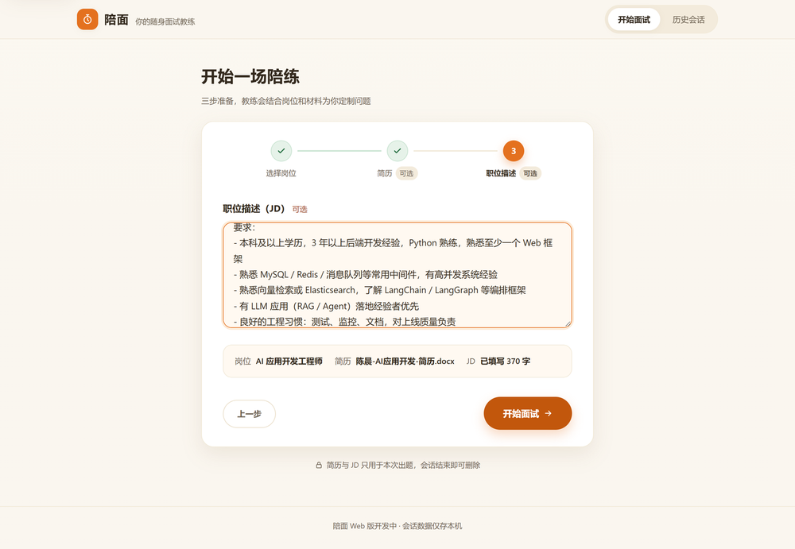
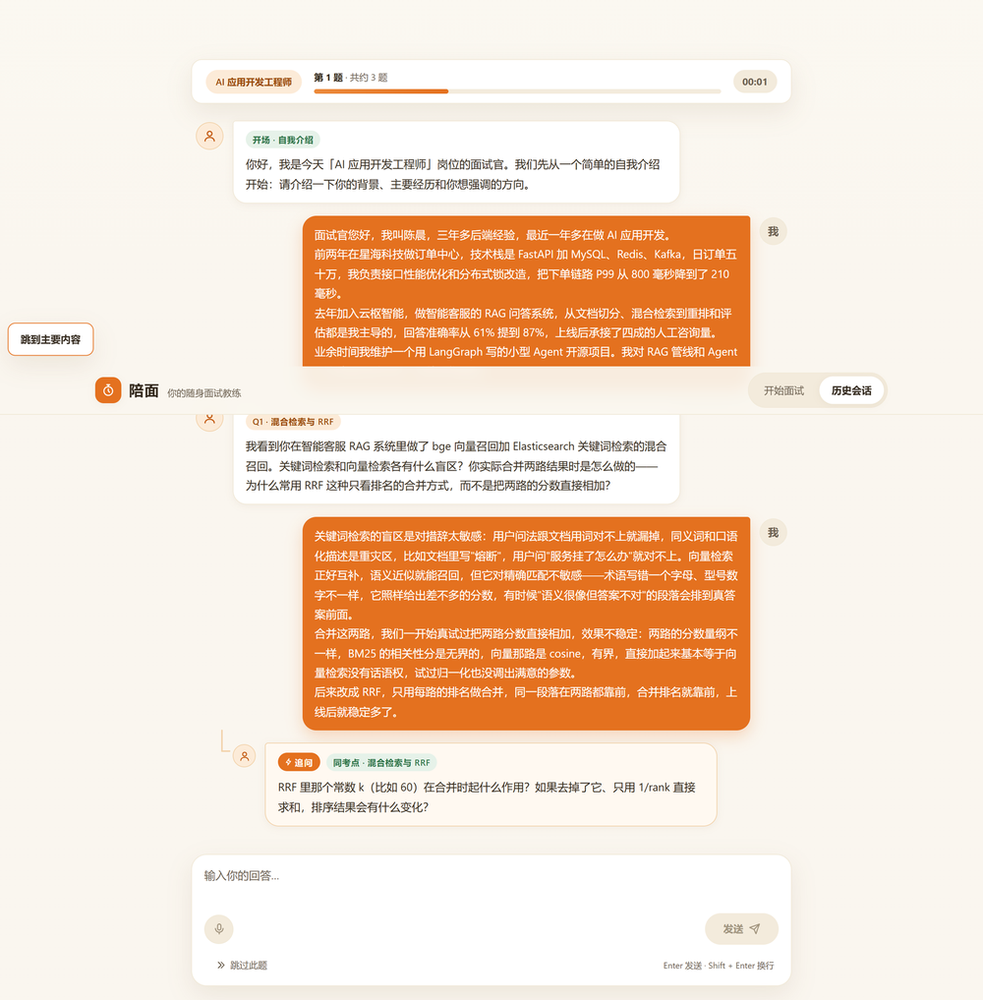
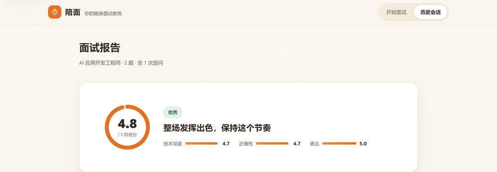
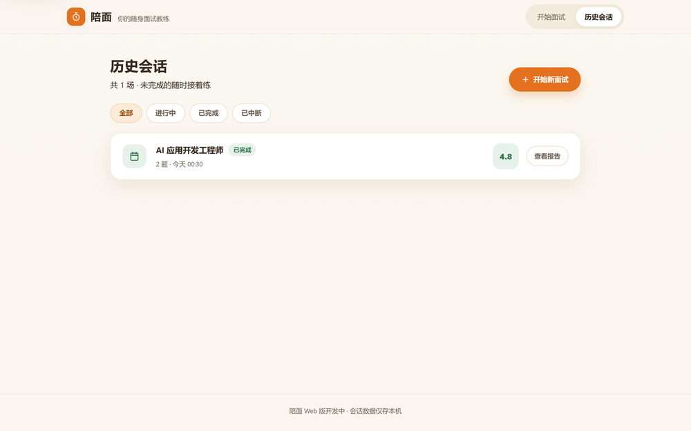

# 陪面 · Interviewer

通用岗位的 AI 模拟面试教练，本地优先的单人项目。CLI 与 Web 两个传输面共用同一个 LangGraph 引擎。

## 它是什么

```
用户输入岗位（必填）+ 上传简历文件（可选，.txt/.md/.pdf/.docx）
  → 自我介绍开场（模仿真实面试）
  → 逐题动态签发：依据简历/JD/自我介绍和已考考点的表现现场出题，每题带溯源
  → 逐题面试：答得好换考点，答得不好同考点变形追问（轮数由图控制，模型无权收场）
  → 题量预算/覆盖足够/连续失败熔断任一触发 → 终场报告
```

错题本与遗忘曲线补考在规划中。

核心设计原则：

- **按需签发、执行流式、全程溯源**——每题现场依据材料签发，带 `source_type/source_ref` 防幻觉
- **流程归图，不归模型**——LLM 只产内容和裁决建议，轮数/熔断/收场权全在图的条件边
- **条件边只读不写**——状态变更都在节点内，每个可变字段有唯一写者
- **降级可见**——结构化 → freetext → 确定性兜底池 → 优雅收场，失败原因进报告，不静默编造
- **本地优先**——markdown + JSON + sqlite，不依赖数据库和云服务

## 演示流程

Web 版一场真实会话的关键画面（接入智谱 GLM；演示用虚构简历与 JD）：

| 三步向导 | 面试（答弱追问） |
|---|---|
|  |  |

| 终场报告 | 会话列表 |
|---|---|
|  |  |

值得留意的几处：题目逐字流式输出（SSE，40–80 字/秒自适应打字机）；答弱时面试官带「追问」徽标在同考点变形追问，答好才换新题；核心考点覆盖即主动收场——题量预算是上限，不是必须问满的目标；终场报告给三维逐题得分，薄弱点带依据和改进建议；会话存本机 SQLite，未完成可续面（Web 端「继续面试」，CLI 端 `--resume`）。

## 项目结构

```
interviewer/          引擎：graph/（图与路由）、agents/（签发与评分节点）、
                      dataflows/（检索：BM25F/稠密/RRF 混合 + 简历段落检索）、
                      web/（FastAPI 传输层）、cli/
webapp/               Next.js 前端（输入向导/面试聊天/终场报告/会话列表，SSE 逐字流式）
corpus/               题库（markdown，200 题）
docs/contract/        前后端共享的契约样本（pytest 与 vitest 对拍同一份数据）
scripts/              评测、题库供给、诊断脚本
tests/                全离线测试
```

## 快速开始（CLI）

```bash
# 1) Python 3.10+
pip install -e ".[dev]"

# 2) 离线体验（无需 API key，LLM 用 mock）
set INTERVIEWER_LLM_PROVIDER=mock     # PowerShell: $env:INTERVIEWER_LLM_PROVIDER="mock"
python -m interviewer.cli.app

# 3) 真实模式：复制 .env.example 为 .env，填 ZHIPU_API_KEY
python -m interviewer.cli.app

# 4) 测试
pytest tests -q
```

真实模式默认用智谱 GLM（OpenAI 兼容端点）；换供应商改 `.env` 里的 `INTERVIEWER_LLM_BASE_URL`。断线后用 `--resume <id>` / `--continue` / `--list` 续面。

## Web 版

后端 `pip install -e ".[api,dev]"`，前端 `cd webapp && npm install`。两个终端起服务：

```powershell
# 终端 A · 后端（127.0.0.1:8000）
$env:PYTHONUTF8 = "1"
$env:INTERVIEWER_LLM_PROVIDER = "mock"    # 离线联调；真会话删掉这行
python -m interviewer.web

# 终端 B · 前端（localhost:3000）
cd webapp
npm run dev
```

几个值得知道的点：

- 前端经 `next.config.ts` 的 rewrite 把 `/api/*` 代理到后端，`proxyTimeout` 调到了
  190s——Next 默认 30s 会掐真收场轮的长响应。改 next.config.ts 要重启 dev server。
- 流式走 `POST /api/sessions/<sid>/answers/stream`（SSE，15s 一次 `: ping` 保活），
  旧版 `POST .../answers` 保留为回退通道。
- `compress: false` 别开回去：dev 代理的 gzip 整流会把 SSE 缓冲到流结束才一次性发出，
  等于流式失效。
- Windows 下 curl 发 JSON 先写进文件再 `--data-binary @file`，直接传参引号和中文都会坏。
- 服务和 CLI 共用 `data/checkpoints.sqlite`，服务运行期间别开新 CLI 会话。
- Ctrl+C 是优雅关闭（预算 330s，等在途回合跑完），等待期别连按。

调试开关（都要在后端启动前设置）：`INTERVIEWER_WEB_TURN_DELAY_MS` 拖长回合、
`INTERVIEWER_WEB_KEEPALIVE_S` 保活间隔、`INTERVIEWER_WEB_STREAM_DISABLED` 流式强降
（验证 legacy 回退）。`scripts/run_web_limbo.py` 在临时库里挂一个引擎中断的会话，
用前端打开它可以看到 410 恢复卡片（先停常规后端，rewrite 固定打 8000 端口）。

冒烟（Git Bash，经前端代理）：

```bash
printf '%s' '{"position":"后端开发"}' > /tmp/pm-create.json
printf '%s' '{"type":"answer","text":"我的自我介绍","expect_qnum":"opening"}' > /tmp/pm-ans.json
curl -s http://localhost:3000/api/health
curl -s -X POST http://localhost:3000/api/sessions -H "Content-Type: application/json" --data-binary @/tmp/pm-create.json
curl -s http://localhost:3000/api/sessions/<sid>
curl -s -X POST http://localhost:3000/api/sessions/<sid>/answers -H "Content-Type: application/json" --data-binary @/tmp/pm-ans.json
curl -sN -X POST http://localhost:3000/api/sessions/<sid>/answers/stream -H "Content-Type: application/json" --data-binary @/tmp/pm-ans.json
curl -s http://localhost:3000/api/sessions
```

真智谱 e2e（默认 skip 不进回归）：`$env:INTERVIEWER_E2E_ZHIPU = "1"` 后跑
`pytest tests/test_e2e_integration.py -q -s`。

## 测试

```bash
pytest tests -q              # 全离线；[api]/dense 可选组缺席时整组跳过
cd webapp
npm run test -- --run        # vitest（Windows 下在 PowerShell 跑）
npm run lint
```

## 非目标

- 语音输入：封存在 `feature/voice-input` 分支（质量/成本比不佳），transport 架构位保留
- MCP：`@tool` 薄封装已满足，等有真实外部集成需求再议
- 多用户 / 公网部署 / 鉴权：api-service 锁本机回环，公网化另立模块且必须先有鉴权
- 云端向量库 / 数据库：本地单用户文件存储足够
- 多面试官人格（压力面/HR 面）：后续可选，注册表已预留
